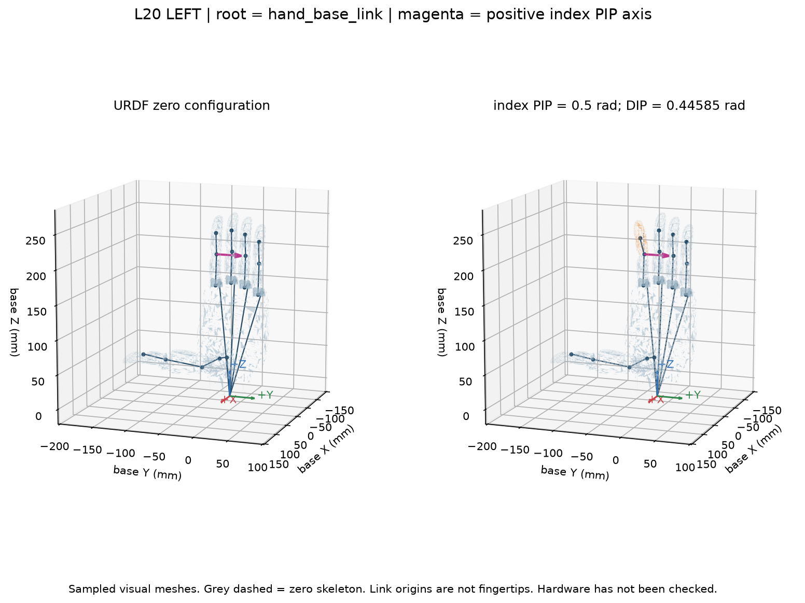

# L20 左手：怎样检查正运动学、坐标与联动

日期：2026-10-16（Asia/Shanghai）。状态：**离线 URDF 计算一致性检查通过；物理尺寸、真实连杆、SDK 与真机尚未验证。**

已经为当前 L20 左手生成检查脚本、固定样例、交互页面和报告。建议先用交互页面看懂单个关节的作用，再查看数值报告；这一步不需要训练网络。

## 1. 三件事分别检查什么

| 检查对象 | 要回答的问题 | 当前能验证到哪里 |
|---|---|---|
| 正运动学 FK | 给定关节角 q，手掌/指节会位于哪里、朝向哪里？ | 自编实现与 yourdfpy 对同一 URDF 的计算是否一致 |
| 坐标 | 位置相对哪个原点？轴在哪个局部系？正转方向是什么？ | 根/关节/网格变换、右手规则与数值导数是否一致 |
| 联动 mimic | 改一个独立关节时，从动关节是否按文件关系改变？ | URDF 的五条固定线性关系与限位展开是否一致 |

这里的 21 个 URDF 转动关节、16 个独立运动学坐标、MANO 的 21 个关键点，是不同对象。独立角度也还不是实际执行器指令 u。

## 2. 先打开交互页面

打开 [L20 离线交互检查器](../experiment/v3_L20运动学核查/l20_fk_viewer.html)。它是一个完整的本地 HTML 文件，不需要网络资源或启动服务；可在资源管理器中双击，选择浏览器打开。

页面包含：选择一个独立关节、弧度滑杆、角度显示、五个从动角度、基座/关节坐标轴、旋转缩放和 q 导出。其他独立关节保持为 0，方便定位当前变化由哪个关节引起。

- 红/绿/蓝箭头分别表示 +X/+Y/+Z。
- 紫红箭头表示所选关节在基座系中的正转轴。
- 橙色网格表示受该关节影响的子树。
- 灰色虚线表示零姿态连接点。
- 网格使用抽样三角面；显示中的空隙不用于判断真实缺面、接触或碰撞。

**验收边界：**浏览器工具拒绝访问本地 file 协议，本轮没有完成自动点击/布局验收。已检查完整 JavaScript 语法，并用 Node 对页面中实际 FK 代码的 114 个姿态、2508 个 link 变换进行比较；与 Python 的最大矩阵元素差为 3.3307e-16。请在本地浏览器完成下面的可视检查。

## 3. 按顺序做五个可视检查

### A. 零姿态与基座坐标

点击“全部归零”。页面根坐标系是 `hand_base_link`。计算单位为米、弧度；显示位置时乘 1000 得到毫米，显示角度时乘 180/π 得到度。

当前模型四根长指沿基座 +Z 一侧延伸；基座原点还不是已经定义好的解剖腕点。零姿态由文件的 q=0 决定，拇指仍保留固定 rpy，它不等于已经验证的自然张手。

转动视图，检查零姿态下部件连接是否连续，手指是否出现在对应位置；再切换侧面查看厚度。若与实物/CAD 明显不符，先查单位、左右手、模型版本与 visual origin，不能用任意缩放或镜像掩盖问题。

### B. 单个指根关节：只有一根手指动

选 `index_mcp_pitch`，把角度从 0 调到 **0.1 rad，约 5.73°**。

应该看到食指的下游部件一起转动，其他四指与基座保持原位。当前关节原点绕自身轴旋转时不应移动，但子部件朝向和下游关节位置会变化。

再选 `index_mcp_roll`，观察它与 `mcp_pitch` 的运动差异。两个机械轴的中心相距约 16.77 mm，不能在后续 MANO 对应中直接把它们都当成同一个人体 MCP 中心。

### C. 食指 PIP 联动

点击“食指联动示例”，页面会设置：

```text
index_pip = 0.5 rad
index_dip = 0.8917 × 0.5 = 0.44585 rad
```

PIP 是近端指间关节，DIP 是远端指间关节。食指中节和末节会变化；食指近节、其他手指不应因本次输入改变。末节绕 DIP 的额外转动会进一步影响末端网格，但 DIP 关节中心的位置只由它的上游决定。

一个可复查数值：本模型零姿态时，`index_pip` 原点在基座系约为 `[-17.290, -26.711, 204.131] mm`。仅改变它自身的角度，该点保持不动；设到 0.5 rad 后，下游 DIP 原点相对零姿态约移动 `[+14.862, 0, -5.202] mm`。这些是文件计算值，未做实物测量。

### D. 拇指与负轴方向

点击“拇指联动示例”：

```text
thumb_mcp = 0.5 rad
thumb_ip  = 1.1619 × 0.5 = 0.58095 rad
```

再单独选 `thumb_cmc_yaw`。其局部轴为 `[-1,0,0]`；正角度是绕这个**负 X 方向轴**按右手规则转，不能把它当成绕 +X 转。其余拇指关节带固定 rpy，关节局部 Y 也不一定与基座 Y 相同。页面底部会打印变换后的基座系转轴。

### E. 限位

观察每个关节的有效范围。例如四指 `mcp_roll` 是 `[-0.17,0.17] rad`，不是 ±0.17 度。页面滑杆/数值输入会限制到有效范围；Python 读取器会拒绝越限、未知关节、以及将从动关节作为独立输入的请求。

限位内的姿态也可能发生碰撞。此次没有碰撞检查，不能将随机测试姿态直接当作可执行抓取轨迹。

## 4. 怎样理解代码里的坐标变换

每个子部件相对基座的变换为：

```text
T_base_child(q) = T_base_parent(q) · T_origin(xyz,rpy) · Rot(axis,q_joint)
T_origin 的旋转 = Rz(yaw) · Ry(pitch) · Rx(roll)
```

`<origin>` 是相对父 link 的固定连接位置/朝向；`<axis>` 属于经过 origin 变换后的关节局部坐标系。正运动学沿树从基座向指尖方向连乘。

三种原点不能混用：

| 字段 | 用途 |
|---|---|
| joint/origin | 机械关节坐标变换 |
| visual/origin 与 mesh/scale | 网格放在 link 内的位置、朝向与尺度 |
| inertial/origin | 惯性/质心参考；不是直接用来定义关节中心或指尖 |

如果要在末节网格上标记指尖，应保存该点在所属 link 的局部坐标，再通过 FK 转到基座系。当前没有把 distal link 原点或网格极值自动当作指尖。

## 5. 重跑自动检查

在 PowerShell 中执行：

```powershell
cd E:\lingqiaoshou\dex-mapping
. .\scripts\activate_mano_l20.ps1
python scripts/check_l20_kinematics.py --output experiment/v3_L20运动学核查/user_check_001
```

第一次运行这个新的输出目录会生成报告、CSV、图和交互页面；再次运行请换新的运行目录，脚本会拒绝覆盖已有 metrics.json。

本轮配置固定在 [config.json](../experiment/v3_L20运动学核查/config.json)：114 个姿态=1 个零姿态+16 个单关节变化+32 个限位端点+40 个固定种子随机姿态+25 个联动扫描。

检查内容包括：

- 每个 link 的位置与朝向，与独立 yourdfpy 实现对照；对方只接收 16 个独立角度并自行展开 mimic。
- 旋转矩阵正交、行列式为 1；只影响自己的子树；当前关节原点保持。
- 局部探针运动的有限差分，与“世界转轴 × 到关节中心的向量”一致，检查正转方向。探针是数值工具，不是指尖。
- 五条联动、展开后所有角度的限位、非法输入拒绝。
- 四指 MCP_pitch→PIP、PIP→DIP 中心距在所有姿态中保持。

## 6. 本次实际结果

| 项目 | 结果 |
|---|---|
| 固定诊断姿态 | 114 个，全部通过所列数值检查 |
| 与 yourdfpy 的最大 link 位置差 | 5.6372e-17 m |
| 与 yourdfpy 的最大 link 朝向差 | 2.2636e-16 rad |
| 子树以外的变换变化 | 0 |
| 自身旋转导致的关节原点位移 | 0 |
| 正转轴有限差分最大差 | 1.0527e-11 m/rad |
| mimic 公式最大残差 | 0 rad |
| 四指已选近节/中节中心距 | 约 45.02 / 31.82 mm，随姿态变化保持在数值容差内 |
| 真实硬件、物理尺度与碰撞 | 未测 |

小到机器精度的差异说明**两套实现对相同文件给出相同答案**，不表示实物有这样的精度。模型长度仍按米制约定解释。



完整产物：

- [复现报告](../experiment/v3_L20运动学核查/复现报告.md)、[metrics.json](../experiment/v3_L20运动学核查/metrics.json)。
- [joint_table.csv](../experiment/v3_L20运动学核查/joint_table.csv)：关节名、父子、局部轴、零姿态基座轴、限位、mimic。
- [zero_configuration.json](../experiment/v3_L20运动学核查/zero_configuration.json)：零姿态的所有变换和 q 顺序。
- [per_case_errors.csv](../experiment/v3_L20运动学核查/per_case_errors.csv)、[mimic_sweeps.csv](../experiment/v3_L20运动学核查/mimic_sweeps.csv)。
- [geometry_audit.json](../experiment/v3_L20运动学核查/geometry_audit.json)：完整网格尺寸范围与来源哈希，显示抽样不参与范围计算。

## 7. 怎样核对真实 L20

没有实物时，先用对应硬件批次的 CAD、产品尺寸图、厂商关节定义和 SDK 标定资料核对。有实物时，再比对几个相同定义的关节中心距、正向小角运动、联动角度/回读；此处仍是后续计划，未运行。

特别需要补齐：SDK 槽位→独立角度的单位/零点/符号；真实连杆关系是否随角度非线性变化；硬件限位是否与 URDF 一致。URDF 的线性 mimic 不自动证明真实机构全范围准确。

## 8. 接下来做什么

先在本地完成可视核对；随后选定解剖对应的腕部点与五个局部指尖点，冻结坐标与语义。再比较“仅尺度”与“β+尺度”的 MANO 几何拟合。此过程是两阶段网络的准备模块，当前还没有得到拟合后的 β_R。

参考实现：[yourdfpy 作者文档](https://yourdfpy.readthedocs.io/en/latest/api/yourdfpy.html)、[ROS urdfdom 姿态定义](https://github.com/ros/urdfdom_headers/blob/master/include/urdf_model/pose.h)。本地版本记录在本轮报告中。
