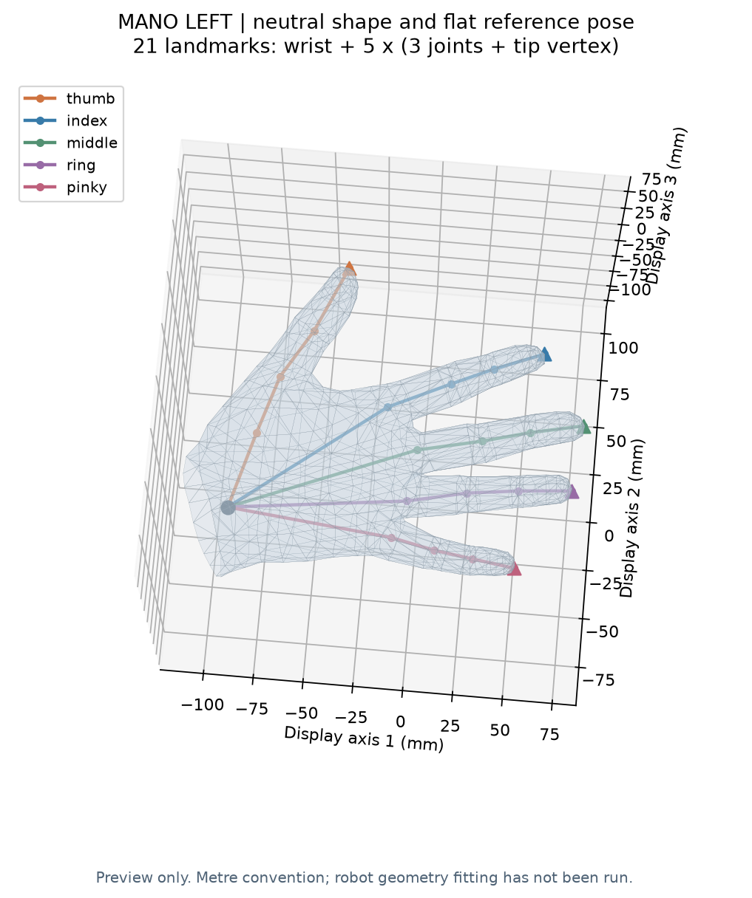

# v2 MANO 环境与加载核查报告

日期：2026-10-14（Asia/Shanghai）。结论：**通过当前环境/模型加载核查；未做机器人几何拟合与训练。**

## 输入与运行

模型路径、左右手与单位约定见 [配置](../../environment/mano_l20_paths.json)。运行 Python 为项目 `.conda/envs/mano-l20/python.exe`，Python 3.11.17；实际包版本与原始 MANO、URDF、22 个网格哈希见 [完整检查报告](environment_check.json)。

命令（项目目录下运行）：

```powershell
. .\scripts\activate_mano_l20.ps1
python -m pip check
python scripts/check_mano_model.py --config environment/mano_l20_paths.json --output experiment/v2_MANO加载兼容修正/user_check_001
```

本轮实际运行保存在当前目录，而上述重跑使用新的运行目录。运行输出见 [run.log](run.log)。

## 实际观察

| 检查项 | 实际结果 |
|---|---|
| pip 依赖一致性 | 通过 |
| PowerShell 激活/退出 | 通过；激活时 Python 指向本环境，退出后回到 base |
| MANO 网格 | 778 顶点，1538 面 |
| MANO 原生关节 / 导出关键点 | 16 / 21 |
| 形状参数 / 局部姿态参数 | 10 / 45 |
| 中性顶点最大绝对差 | 6.308303282520633e-9 模型单位 |
| 中性关节最大绝对差 | 6.210221087377121e-10 模型单位 |
| 加载一致性容差 | 1.3593493015069139e-7 模型单位 |
| 形状梯度 | 有限、非零 |
| 指定局部轴角扰动后最大顶点位移 | 0.002880042710342894 模型单位 |
| L20 资源 | URDF 存在，22 个引用网格均存在 |
| L20 FK / 驱动 / R 拟合 / 训练 | 未运行 |

smplx 构造缓冲区前存在 float32 转换，所以上述差异并非模型读取失败。容差用于验证读取和前向的数值一致性，不代表重定向精度。



## 保存产物

- [landmarks_mano21.json](landmarks_mano21.json)：腕、拇、食、中、无名、小顺序；米制模型约定、原始坐标、指尖顶点索引。
- `mano_reference.npz`：中性网格、面、原生关节、21 点与输入参数。
- `mano_neutral.obj`：参考网格，未改变到机器人尺寸。
- [environment_check.json](environment_check.json)：软件、源文件哈希、数值检查与资源边界。

没有加载真实控制接口、没有定义 L20 的腕部/指尖点，未对单帧调试样本作任何泛化结论。下一步按 M1 做机器人 FK 与尺度检查。
